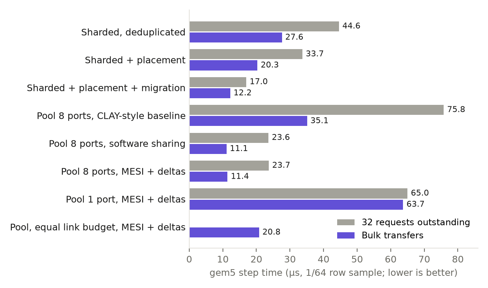
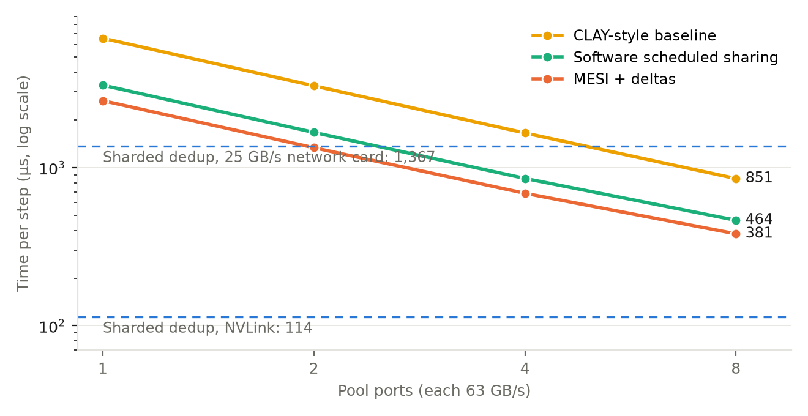

## Summary

We asked whether 8 GPUs training a recommendation model (DLRM) can keep their
embedding tables in a shared CXL memory pool, and how that compares with what
industry does today: tables sharded across the GPUs and exchanged all-to-all.

- **Against an uncacheable (CLAY-style) pool, our design is 2.2 to 3.2 times
  faster.** This holds in every experiment.
- **Against sharding, the answer depends on the links.** Inside one machine,
  sharding over NVLink is 3.3 times faster than our best pool design. Across
  machines on 25 GB/s network cards, our pool design is 3.6 times faster than
  sharding.
- **The pool needs about 8 ports.** With one port it loses to every sharded
  design except the unoptimized one.
- **A software schedule nearly matches the hardware protocol.** The protocol
  change is ahead by 18% at 8 ports in the full-scale model and ties in gem5.

The claim we can defend is: *if* embedding memory is pooled over CXL for
capacity or cost, these changes make it about twice as fast, and competitive
with sharding once GPUs are spread across machines. We did not measure cost.

## The design

Each training step, every GPU reads the embedding rows its samples use and
then updates them. Three changes to the uncacheable pool:

1. **Sample placement (software).** Decide which GPU gets which sample so
   that samples using the same rows land on the same GPU. More rows become
   private to one GPU. Training is unchanged, because the summed gradient
   does not depend on which GPU computes which sample.
2. **MESI coherence on the pool.** A GPU that is a row's only user keeps it
   cached and updates it locally, with no traffic to the pool.
3. **Gradient deltas for shared rows.** Each GPU sends its update as a delta
   that the pool merges. No GPU needs exclusive ownership, and no copies are
   invalidated. CXL has no cache-to-cache forwarding, so plain MESI is slow
   on shared rows; deltas remove that cost.

The software alternative to 2 and 3 is *scheduled sharing*: the data loader
knows future batches, so it tells each GPU which rows to keep and when to
write them back.

## Experiments

| Experiment | Tool | Size |
|---|---|---|
| Whole-step timing of 4 sharded and 9 pool designs, 1 to 8 pool ports | gem5 (SimCXL, Ruby protocol with our changes) | 112 runs |
| Sensitivity: port bandwidth, hop latency, second step window, second Criteo day, 8x scale | gem5 | 80 runs |
| Bulk transfers (large request window) for all main designs; equal total link bandwidth | gem5 | 86 runs |
| Full-batch step time with real NVLink, network-card and CXL figures | Link-level model (`linkmodel.py`) | 40 runs |
| GPU cache size needed by the MESI design | Link-level model | 6 runs |
| Does placement change training? | Real DLRM training, 40 steps | 1 run |
| Placement speed and the cost of running it as a pipeline | Placer in C, link-level model | 5 runs |

All runs use the same Criteo 1TB batches: 65,536 samples per step, 26 tables,
512-byte rows, 8 GPUs. gem5 replays a 1/64 sample of the rows; the link-level
model uses every row.

## Results

### 1. gem5: every design in one simulator

{width=88%}

- **Scheduling matters more than the memory layout.** Deduplication,
  placement and keeping rows where they are used cut the sharded step from
  161 µs (one transfer per lookup) to 12 µs, and the pool step from 35 to 11.
- **Bulk transfers matter.** With 32 outstanding requests every design is
  limited by link latency. Real all-to-all sends one bulk message per GPU
  pair, so the violet bars are the fair comparison.
- **The pool's lead depends on extra links.** With 8 pool ports the pool has
  twice the total link bandwidth of the sharded system. At equal total
  bandwidth the pool (20.8 µs) ties sharding with placement (20.3) and loses
  to sharding with row migration (12.2).
- **Row migration is our construction.** Production systems use static
  sharding plans. We built migration as the strongest possible sharded
  competitor, and it gets its ownership directory for free.

### 2. Real link speeds, full batch

{width=92%}

NVLink gives a GPU 300 GB/s per direction (A100) against about 63 GB/s for
one CXL port on PCIe 5.0. Meta's ZionEX connects GPUs across machines with
one 25 GB/s network card per GPU.

- **One machine:** deduplicated sharding over NVLink (114 µs) is 3.3 times
  faster than the best pool design (381 µs). A PCIe 6.0 CXL port (121 GB/s)
  brings the pool to 199 µs, still slower.
- **Several machines:** the best pool design is 3.6 times faster than
  deduplicated sharding on network cards (1,367 µs) and 1.5 times faster than
  sharding with row migration (578 µs).
- **Against the uncacheable pool:** 2.2 times faster at 8 ports (381 against
  851 µs) and 2.5 times at one port.

For scale: a full training step on 8 GPUs takes roughly 3 to 4 ms (our
estimate from MLPerf results, not verified). The embedding traffic above is
then 3% of a step for NVLink sharding, 11% for the pool, and 39% for
sharding on network cards.

### 3. How many pool ports

{width=88%}

The pool link is the bottleneck until it matches the GPUs' combined
bandwidth. The MESI design needs 2 ports to match sharding on network cards
and never reaches sharding on NVLink.

### 4. Hardware protocol against software schedule

| Pool ports | Software scheduled sharing | MESI + deltas | Tool |
|---|---|---|---|
| 8 | 11.1 µs | 11.4 µs | gem5, bulk |
| 1 | 74.7 µs | 63.7 µs | gem5, bulk |
| 8 | 464 µs | 381 µs | link model, full batch |
| 1 | 3,312 µs | 2,644 µs | link model, full batch |

The hardware protocol is 15 to 20% ahead when the pool link is the
bottleneck. At 8 ports the two tools disagree (tie in gem5, 18% in the
model), so we do not claim a hardware advantage there.

### 5. Placement

- **Training is unchanged.** After 40 steps of real DLRM training the weights
  differ by 1.8e-14 (rounding) and held-out AUC is 0.660481 with and without
  placement.
- **It reduces sharing.** (GPU, row) pairs per step fall from 296,613 to
  213,522.
- **It is slow enough to need a pipeline.** The placer takes 28 to 41 ms per
  step on one core, about ten times a training step. Run as a pipeline, it
  cannot see which GPU held a row in the most recent steps.

| Placement | MESI + deltas, 8 ports (µs) |
|---|---|
| None | 728 |
| Lag of 1 step (not achievable at this speed) | 381 |
| Lag of 4 steps | 452 |
| Lag of 8 steps | 468 |
| Lag of 16 steps | 492 |

A realistic pipeline keeps about two thirds of the benefit: 1.5 times
instead of 1.9 times.

### 6. Other checks

- **GPU cache size.** The MESI design's gain saturates at about 200,000
  cached rows per GPU, roughly 100 MB. This is negligible next to GPU memory.
- **Protocol bug found and fixed.** When the pool recalled a row from its
  owner, the owner kept a copy that later deltas never invalidated, so it
  could read stale data. The owner now drops its copy. The fix costs about
  1.5% (23.4 to 23.7 µs at 8 ports).
- **Robustness.** The bulk results repeat on a second step window and a
  second Criteo day within 8%. At 8x trace scale the order is the same
  (sharded dedup 202 µs, + placement 151, + migration 89; pool baseline 260,
  software 89.5, MESI + deltas 82.7).

## How far to trust the link-level model

The model computes the bytes each design sends over each link from the same
batches, and shares link bandwidth fairly among transfers. Checked against
gem5 at the same sample rate and message sizes:

| Design | gem5 (µs) | Model (µs) | Difference |
|---|---|---|---|
| Pool 1 port, software sharing | 74.8 | 74.0 | -1% |
| Pool 1 port, MESI + deltas | 63.6 | 59.4 | -7% |
| Pool 8 ports, software sharing | 11.1 | 10.6 | -5% |
| Pool 8 ports, MESI + deltas | 10.1 | 8.7 | -14% |
| Pool 8 ports, CLAY-style baseline | 35.2 | 28.6 | -19% |
| Sharded + placement | 18.9 | 14.6 | -23% |
| Sharded + placement + migration | 10.2 | 8.0 | -21% |

The model is always faster than gem5, by up to 23% for the sharded designs.
Part of the gap is gem5 emulating an uncacheable device through a small
cache, where evictions stall later reads. We did not close the gap. The
ordering of designs agrees in both tools except for near-ties.

## Claims

**Supported by the evidence**

- Given a CXL pool, placement plus MESI plus deltas is 2.2 to 3.2 times
  faster than an uncacheable pool.
- Deltas let MESI work on CXL without cache-to-cache forwarding.
- Placement does not change training results.
- The pool design beats sharding when GPUs are connected by 25 GB/s network
  cards and the pool has at least 2 ports.

**Not supported**

- "A CXL pool is faster than sharded all-to-all." Inside one NVLink machine
  it is 3.3 times slower.
- "The hardware protocol is needed." A software schedule is within 18% and
  ties in gem5 at 8 ports.
- "Pooling is cheaper." Cost was not measured. Production systems already
  hold overflow tables in host DRAM, which is as cheap as pool memory; that
  design was not modelled and is the most important missing baseline.

## Limits

- Only embedding traffic is timed. GPU compute is an outside estimate.
- No GPU with a CXL port exists; one 63 GB/s port per GPU is an assumption.
- Measured CXL devices deliver about half their theoretical bandwidth, which
  the model does not include.
- The CLAY-style baseline is our extension of CLAY (an inference design) to
  training, not numbers from that paper.
- One workload: Criteo, 8 GPUs, one ID per feature.
- The protocol changes ran correctly on these traces but were not formally
  verified or stress-tested with random traffic.
- Novelty was judged from memory, without a literature search. The individual
  mechanisms are known (MESI on CXL, COUP-style commutative updates,
  affinity placement); the combination and the measurements are ours.

## Files

Repository `eecs570-cxl-coherence`, branch `v2-barrier-criteo-selective`.

| What | Where |
|---|---|
| gem5 results | `analysis/results_gem5_port_{matrix,checks,bulk,bulk2,fix}.csv` |
| Link-level model and its runs | `analysis/linkmodel.py`, `slurm/v2/linkmodel.sbatch` |
| Trace generators | `analysis/gen_step_traces.py`, `analysis/gen_shard_traces.py` |
| Placement | `analysis/sample_placement.py`, `analysis/placer.c`, `analysis/placement_check.py` |
| Simulator changes | `patches/simcxl-v4-commutative.patch`, `patches/simcxl-v5-downgrade.patch` |
| Figures | `analysis/report/make_figs.py` |
