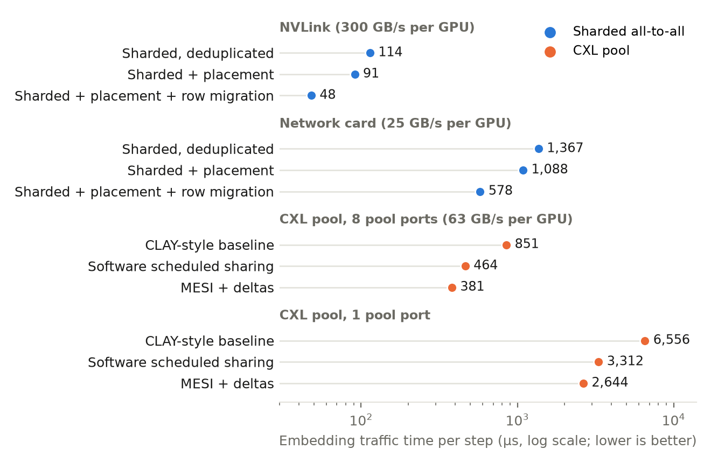

## Summary

**Scope.** We study embedding tables held in a shared CXL memory pool for
multi-GPU recommendation (DLRM) training, and propose an optimization of
that pool: coherent caching of rows at the GPUs (MESI), merged gradient
updates for shared rows (deltas), and sample placement. We compare against
other pooled designs. Sharded all-to-all over NVLink and host memory are
shown as reference points; we do not claim to beat them.

- **Against an uncacheable (CLAY-style) pool, our design is 2.2 to 3.2 times
  faster** on embedding traffic for one-ID-per-feature data, and 1.2 to 2.3
  times faster for multi-hot data, depending on the GPU cache size.
- **Against a pool that pools bags at the memory (as ReCXL and RecDM do), the
  two are complementary.** With one ID per feature our design is about 2
  times faster, because cached private rows need no transfer at all. With
  large bags the near-memory pool is 2 to 16 times faster, because it sends
  one vector per bag where we fetch every row.
- **The pool needs about 8 ports.** With one port every pooled design is
  several times slower.
- **A software schedule comes close to the hardware protocol** (within 18%),
  because the data loader knows future batches.
- **Reference points:** sharding over NVLink is 3.3 times faster than our
  pool on embedding traffic (7% end to end with one ID per feature), and host
  memory with the same scheduling ties it. Pooling is 4 to 10 times cheaper
  per GB than GPU memory; host DRAM is as cheap.

## The design

Each training step, every GPU reads the embedding rows its samples use and
then updates them. Three changes to the uncacheable pool:

1. **Sample placement (software).** Decide which GPU gets which sample so
   that samples using the same rows land on the same GPU. More rows become
   private to one GPU. Training is unchanged, because the summed gradient
   does not depend on which GPU computes which sample.
2. **MESI coherence on the pool.** A GPU that is a row's only user keeps it
   cached and updates it locally, with no traffic to the pool.
3. **Gradient deltas for shared rows.** Each GPU sends its update as a delta
   that the pool merges. No GPU needs exclusive ownership, and no copies are
   invalidated. CXL has no cache-to-cache forwarding, so plain MESI is slow
   on shared rows; deltas remove that cost.

The software alternative to 2 and 3 is *scheduled sharing*: the data loader
knows future batches, so it tells each GPU which rows to keep and when to
write them back.

## Experiments

| Experiment | Tool | Size |
|---|---|---|
| Whole-step timing of 4 sharded and 9 pool designs, 1 to 8 pool ports | gem5 (SimCXL, Ruby protocol with our changes) | 112 runs |
| Sensitivity: port bandwidth, hop latency, second step window, second Criteo day, 8x scale | gem5 | 80 runs |
| Bulk transfers (large request window) for all main designs; equal total link bandwidth | gem5 | 86 runs |
| Full-batch step time with real NVLink, network-card and CXL figures; host-memory hybrid | Link-level model (`linkmodel.py`) | 50 runs |
| GPU cache size needed by the MESI design | Link-level model | 6 runs |
| Does placement change training? | Real DLRM training, 40 steps | 1 run |
| Placement speed and the cost of running it as a pipeline | Placer in C, link-level model | 5 runs |
| Real step time on an A100 slice; host-memory gather and update rates | PyTorch on GPU; C + OpenMP on a 36-core server | 3 runs |

All runs use the same Criteo 1TB batches: 65,536 samples per step, 26 tables,
512-byte rows, 8 GPUs. gem5 replays a 1/64 sample of the rows; the link-level
model uses every row.

## Results

### 1. gem5: every design in one simulator

{width=88%}

- **Scheduling matters more than the memory layout.** Deduplication,
  placement and keeping rows where they are used cut the sharded step from
  161 µs (one transfer per lookup) to 12 µs, and the pool step from 35 to 11.
- **Bulk transfers matter.** With 32 outstanding requests every design is
  limited by link latency. Real all-to-all sends one bulk message per GPU
  pair, so the violet bars are the fair comparison.
- **The pool's lead depends on extra links.** With 8 pool ports the pool has
  twice the total link bandwidth of the sharded system. At equal total
  bandwidth the pool (20.8 µs) ties sharding with placement (20.3) and loses
  to sharding with row migration (12.2).
- **Row migration is our construction.** Production systems use static
  sharding plans. We built migration as the strongest possible sharded
  competitor, and it gets its ownership directory for free.

### 2. Real link speeds, full batch

{width=92%}

NVLink gives a GPU 300 GB/s per direction (A100) against about 63 GB/s for
one CXL port on PCIe 5.0. Meta's ZionEX connects GPUs across machines with
one 25 GB/s network card per GPU.

- **One machine:** deduplicated sharding over NVLink (114 µs) is 3.3 times
  faster than the best pool design (381 µs). A PCIe 6.0 CXL port (121 GB/s)
  brings the pool to 199 µs, still slower.
- **Several machines:** the best pool design is 3.6 times faster than
  deduplicated sharding on network cards (1,367 µs) and 1.5 times faster than
  sharding with row migration (578 µs).
- **Against the uncacheable pool:** 2.2 times faster at 8 ports (381 against
  851 µs) and 2.5 times at one port.

For scale: GPU compute per step is about 4 ms on a whole A100 (measured on
a slice and scaled, section 8). The embedding traffic above is
then 3% of a step for NVLink sharding, 11% for the pool, and 39% for
sharding on network cards.

### 3. How many pool ports

{width=88%}

The pool link is the bottleneck until it matches the GPUs' combined
bandwidth. The MESI design needs 2 ports to match sharding on network cards
and never reaches sharding on NVLink.

### 4. Hardware protocol against software schedule

| Pool ports | Software scheduled sharing | MESI + deltas | Tool |
|---|---|---|---|
| 8 | 11.1 µs | 11.4 µs | gem5, bulk |
| 1 | 74.7 µs | 63.7 µs | gem5, bulk |
| 8 | 464 µs | 381 µs | link model, full batch |
| 1 | 3,312 µs | 2,644 µs | link model, full batch |

The hardware protocol is 15 to 20% ahead when the pool link is the
bottleneck. At 8 ports the two tools disagree (tie in gem5, 18% in the
model), so we do not claim a hardware advantage there.

### 5. Placement

- **Training is unchanged.** After 40 steps of real DLRM training the weights
  differ by 1.8e-14 (rounding) and held-out AUC is 0.660481 with and without
  placement.
- **It reduces sharing.** (GPU, row) pairs per step fall from 296,613 to
  213,522.
- **It is slow enough to need a pipeline.** The placer takes 28 to 41 ms per
  step on one core, about ten times a training step. Run as a pipeline, it
  cannot see which GPU held a row in the most recent steps.

| Placement | MESI + deltas, 8 ports (µs) |
|---|---|
| None | 728 |
| Lag of 1 step (not achievable at this speed) | 381 |
| Lag of 4 steps | 452 |
| Lag of 8 steps | 468 |
| Lag of 16 steps | 492 |

A realistic pipeline keeps about two thirds of the benefit: 1.5 times
instead of 1.9 times.

### 6. Other checks

- **GPU cache size.** The MESI design's gain saturates at about 200,000
  cached rows per GPU, roughly 100 MB. This is negligible next to GPU memory.
- **Protocol bug found and fixed.** When the pool recalled a row from its
  owner, the owner kept a copy that later deltas never invalidated, so it
  could read stale data. The owner now drops its copy. The fix costs about
  1.5% (23.4 to 23.7 µs at 8 ports).
- **Robustness.** The bulk results repeat on a second step window and a
  second Criteo day within 8%. At 8x trace scale the order is the same
  (sharded dedup 202 µs, + placement 151, + migration 89; pool baseline 260,
  software 89.5, MESI + deltas 82.7).

### 7. Host memory and cost

Production systems already keep tables that do not fit in GPU memory in the
server's own DRAM. We added that design to the link-level model: rows in host
memory, fetched and updated over each GPU's PCIe link as bulk transfers. A
GPU's CXL port and its PCIe port are the same physical link (63 GB/s).

| Design | Memory side serves | Time per step (µs) |
|---|---|---|
| Host memory, as deployed (no placement, no GPU cache) | 504 GB/s | 676 |
| Host memory + placement + lookahead GPU cache | 504 GB/s | 385 |
| Host memory + placement + lookahead GPU cache | 200 GB/s | 880 |
| Host memory + placement + lookahead GPU cache | 100 GB/s | 1,734 |
| CXL pool, MESI + deltas, 8 ports | 504 GB/s | 381 |
| CXL pool, MESI + deltas, 4 ports | 252 GB/s | 687 |

- **At equal memory-side bandwidth the pool and host memory tie** (381
  against 385 µs). The pool has no speed advantage inside one server.
- **The pool is ahead only if it serves rows faster than the host can.**
  Published host platforms read about 77 to 110 GB/s. Measured CXL devices
  deliver about half their theoretical bandwidth, which would put the pool
  near the 4-port row. Section 8 replaces these published figures with our own
  measurement.

Cost of holding 2 TB of embedding tables for 8 GPUs (prices from November
2026 web sources; several are secondary or estimates):

| Option | Memory price | Cost for 2 TB | Extra hardware |
|---|---|---|---|
| GPU memory (more H100s) | about $390/GB | about $780,000 | 17 more GPUs |
| Host DRAM (DDR5 RDIMM) | about $40/GB | about $80,000 | none; one server holds up to 8 TB |
| CXL pool | $40 to $100/GB (no public list price) | $80,000 to $200,000 | pooling chassis, about $12,000 (unverified quote) |

- **Pooling is about 4 to 10 times cheaper than GPU memory**, but so is host
  DRAM, with no switch and with hardware that exists today.
- **DDR5 prices rose about tenfold in the last year** (about $4/GB in Q3
  2025). Before the rise the gap to GPU memory was near 100 times.
- **The cost argument is already published for host memory.** ScratchPipe
  (ISCA'22) reports a lookahead GPU cache within 29 to 66% of all-in-GPU
  speed at 4 times lower cost. BagPipe (SOSP'23) reports up to 5.6 times
  over a host-memory baseline.
- **Where a pool could still be cheaper:** tables above one server's 8 TB,
  or memory shared by several servers. We did not model either.

### 8. Measurements on real hardware

We ran an MLPerf-size DLRM on the real Criteo batches on one A100 slice
(40 GB, about 3/7 of the card's compute; the class account allows one GPU),
and measured how fast host memory serves rows on a 36-core server.

| One GPU's share of a step (8,192 samples), mixed precision | Time |
|---|---|
| Forward + backward + dense update | 9.4 ms |
| Embedding lookup, tables in GPU memory | 0.48 ms |
| Embedding update, tables in GPU memory | 1.17 ms |

Scaled by 7/3, compute on a whole A100 would be about 4 ms. This is plain
PyTorch; tuned frameworks are faster.

| Host memory, 99 GB table, rows of one step (150 MB each way) | Gather | Update |
|---|---|---|
| Plain PyTorch, 8 threads | 15.6 GB/s (9.8 ms) | 7.4 GB/s (20.7 ms) |
| C + OpenMP with prefetch, 16 threads | 33.5 GB/s (4.5 ms) | 40.0 GB/s (3.8 ms) |
| C + OpenMP with prefetch, 32 threads | 36.4 GB/s (4.1 ms) | 57.1 GB/s (2.6 ms) |

- **Compute dominates.** At 4 to 9 ms per step, GPU compute is 10 to 25
  times the pool's embedding traffic (0.38 ms). Differences between designs
  shrink accordingly.
- **Host memory is limited by the CPU, not the link.** Even tuned, the host
  serves 36 to 57 GB/s, far below the 100 to 504 GB/s assumed in section 7.
  Serving one step takes 6.8 ms on all 32 cores, or about 3.6 ms with our
  placement and GPU cache (which cut the rows by 47%).
- **End to end, the pool is 1.0 to 1.6 times faster than host memory.** With
  lookahead the host work overlaps GPU compute, so a host-memory step is
  about max(compute, host work) plus transfer: 4.4 to 7.2 ms on a whole A100,
  against 4.4 to 4.7 ms for the pool. On the slice we measured (9.4 ms
  compute) the two are equal.
- **The pool's real advantage over host memory is freeing the CPU.** The
  host design keeps 16 to 32 cores busy moving rows. This assumes the pool
  itself serves 250 to 500 GB/s, which we did not measure.

### 9. Multi-hot features and other pooled designs

Production models look up many IDs per feature. We expanded the Criteo
batches with the MLPerf DLRM-DCNv2 multi-hot recipe (214 lookups per sample
instead of 26; 2.8 million rows per step instead of 165,000) and added a
near-memory pool to the link-level model: the pool sums each bag and returns
one vector, and one gradient vector per bag goes back. This is the approach
of ReCXL (ISCA 2024, one GPU) and RecDM (TACO 2026, several GPUs), modelled
here without any limit on the pool's internal memory bandwidth.

Embedding traffic per step, pool with 8 ports, full batch:

| Pooled design | One ID per feature | Multi-hot |
|---|---|---|
| Uncacheable (CLAY-style) | 0.67 ms | 15.7 ms |
| Software scheduled sharing | 0.46 ms | 10.3 to 14.4 ms |
| Ours: MESI + deltas, unlimited GPU cache | 0.38 ms | 6.8 to 8.8 ms |
| Ours: MESI + deltas, 0.5 to 2 GB GPU cache | 0.38 ms | 11.0 to 12.6 ms |
| Near-memory pooling, one exchange per lookup | 4.35 ms | 4.35 ms |
| Near-memory pooling, identical bags deduplicated | 0.81 ms | 0.81 ms |
| Reference: sharded, pooled vectors over NVLink | 0.78 ms | 0.80 ms |

- **Coherent caching wins when bags are small.** With one ID per feature
  there is nothing to pool, and a cached private row costs no traffic.
- **Near-memory pooling wins when bags are large.** Its traffic does not grow
  with bag size; ours grows with the number of rows.
- **The pool's own memory is the limit for near-memory designs.** It must
  read and update 2.7 to 13 million rows per step, which needs 0.3 to 1.5
  TB/s inside the pool. ReCXL and RecDM address this with processing in many
  memory modules; we did not model it.
- **Deltas against plain MESI.** With bulk transfers the delta mechanism is
  1.14 times faster than plain MESI at 8 ports in gem5 and 10% slower at one
  port; the link-level model shows no difference. Its value is correctness
  without cache-to-cache forwarding more than speed.
- **Checks that did not pan out.** Keeping whole bags on GPUs in front of a
  near-memory pool gained at most 1.13 times. Moving row ownership between
  GPUs in a sharded system gained nothing against pooled all-to-all.
  Sharing one pool between training and serving has no accuracy benefit: a
  serving model one minute behind the trainer loses 0.006% in log loss.

## How far to trust the link-level model

The model computes the bytes each design sends over each link from the same
batches, and shares link bandwidth fairly among transfers. Checked against
gem5 at the same sample rate and message sizes:

| Design | gem5 (µs) | Model (µs) | Difference |
|---|---|---|---|
| Pool 1 port, software sharing | 74.8 | 74.0 | -1% |
| Pool 1 port, MESI + deltas | 63.6 | 59.4 | -7% |
| Pool 8 ports, software sharing | 11.1 | 10.6 | -5% |
| Pool 8 ports, MESI + deltas | 10.1 | 8.7 | -14% |
| Pool 8 ports, CLAY-style baseline | 35.2 | 28.6 | -19% |
| Sharded + placement | 18.9 | 14.6 | -23% |
| Sharded + placement + migration | 10.2 | 8.0 | -21% |

The model is always faster than gem5, by up to 23% for the sharded designs.
Part of the gap is gem5 emulating an uncacheable device through a small
cache, where evictions stall later reads. We did not close the gap. The
ordering of designs agrees in both tools except for near-ties.

## Claims

**What we claim**

- For a CXL embedding pool, coherent caching with merged updates and sample
  placement is 2.2 to 3.2 times faster than an uncacheable pool on embedding
  traffic (one ID per feature), and 1.2 to 2.3 times faster on multi-hot
  data.
- Merged updates let MESI work on CXL, which has no cache-to-cache
  forwarding.
- Placement does not change training results.
- Coherent caching and near-memory pooling are complementary: the first
  wins for small bags, the second for large ones.

**What we do not claim**

- That a CXL pool beats sharded all-to-all. Over NVLink sharding is 3.3
  times faster on embedding traffic.
- That the hardware protocol is required. A software schedule is within 18%.
- That pooling is the cheapest option. Host DRAM costs the same or less.
- That our design beats ReCXL or RecDM. We modelled their approach, not
  their systems, and on multi-hot data it is faster than ours.

## Limits

- GPU compute was measured on one A100 slice with plain PyTorch and scaled
  to a whole card; no 8-GPU run was possible.
- No GPU with a CXL port exists; one 63 GB/s port per GPU is an assumption.
- Measured CXL devices deliver about half their theoretical bandwidth, which
  the model does not include.
- The CLAY-style baseline is our extension of CLAY (an inference design) to
  training, not numbers from that paper.
- One workload: Criteo, 8 GPUs, one ID per feature.
- The protocol changes ran correctly on these traces but were not formally
  verified or stress-tested with random traffic.
- Prior work: ReCXL (ISCA'24) and RecDM (TACO'26), both read in full, pool
  bags at the memory and keep GPUs consistent in software; TrainingCXL
  applies updates at the memory on one GPU; Herald (NSDI'24) places inputs
  on workers. We found no paper with MESI-style caching plus merged gradient
  updates for a CXL pool shared by several GPUs.
- The multi-hot data is synthetic (MLPerf recipe); its extra rows are drawn
  uniformly, so real bags may share more.
- Prices are from secondary web sources; CXL module and switch prices are
  not public.

## Files

Repository `eecs570-cxl-coherence`, branch `v2-barrier-criteo-selective`.

| What | Where |
|---|---|
| gem5 results | `analysis/results_gem5_port_{matrix,checks,bulk,bulk2,fix}.csv` |
| Link-level model and its runs | `analysis/linkmodel.py`, `slurm/v2/linkmodel.sbatch` |
| Trace generators | `analysis/gen_step_traces.py`, `analysis/gen_shard_traces.py` |
| Placement | `analysis/sample_placement.py`, `analysis/placer.c`, `analysis/placement_check.py` |
| Simulator changes | `patches/simcxl-v4-commutative.patch`, `patches/simcxl-v5-downgrade.patch` |
| Figures | `analysis/report/make_figs.py` |
